<p align="center">
  
</p>

# Sentinela

**Painel de inteligência territorial que antecipa riscos climáticos, desperdício de recursos e demanda por serviços, com alertas preditivos transparentes. A decisão final é sempre humana.**

> Global Solution 2026.2 · Cross-Platform Application Development · FIAP
> Desafio: *Territory Predictive Insights* (tema CitizenTech)

---

## 1. Problema e público

Cidades de médio porte sofrem com eventos que poderiam ser antecipados: alagamentos em bairros ribeirinhos, deslizamentos em encostas ocupadas, incêndios em períodos de seca, vazamentos que passam semanas sem detecção e picos de energia em ondas de calor. Os dados existem, mas chegam dispersos e sem explicação, e a decisão acaba sendo reativa.

O **Sentinela** (quem vigia e avisa antes do perigo) reúne esses sinais num único painel mobile para dois públicos:

| Público | O que ganha |
|---|---|
| **Gestores públicos** (Defesa Civil, secretarias de infraestrutura e meio ambiente) | Alertas com justificativa, nível de confiança e limitações explícitas, limiares ajustáveis ao território e histórico de 30 dias por indicador. |
| **Cidadãos** | Visão clara do que está acontecendo na sua região, canal anônimo para relatar ocorrências e transparência sobre como os alertas são gerados. |

**Impacto social esperado:** reduzir o tempo entre o sinal e a ação preventiva, ampliar a cobertura dos avisos à população (indicador exibido no app: *moradores cobertos por alertas nas últimas 24h*) e dar voz às regiões por meio dos relatos de cidadãos, sem coletar dados pessoais.

O território monitorado é **Vale Verde**, um município fictício de 77,5 mil habitantes em 6 regiões, ancorado nas coordenadas de São Paulo para consumir dados reais de clima.

## 2. Integrantes

| Nome completo | RM |
|---|---|
| [Bernardo Berwanger] | [RM565776] |
| [João Vitor Angeloti Sena] | [RM563473] |

## 3. Demonstração visual

Todos os prints estão em `assets/screenshots/`.

| Consentimento | Login | Cadastro |
|:---:|:---:|:---:|
| 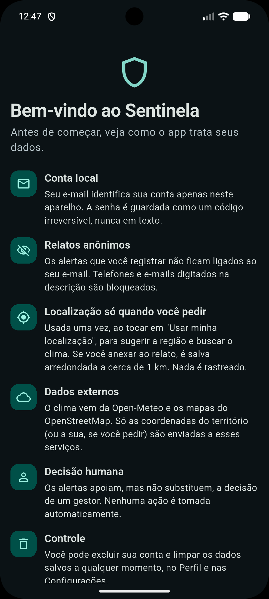 | 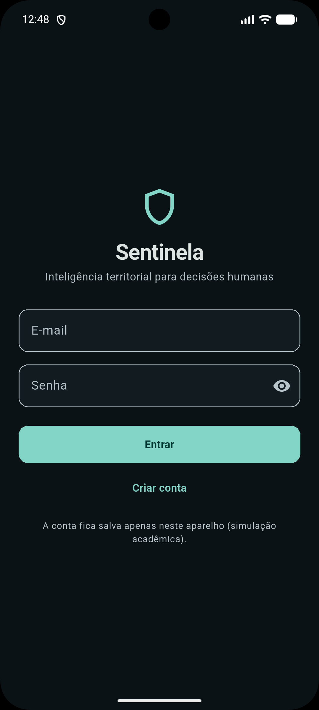 |  |
| Etapa obrigatória no primeiro uso: explica o que é coletado e para quê. | Conta local; a senha é guardada como hash com sal. | Validação de e-mail, força da senha e consentimento explícito. |

| Início | Detalhe do alerta | Registrar alerta |
|:---:|:---:|:---:|
| 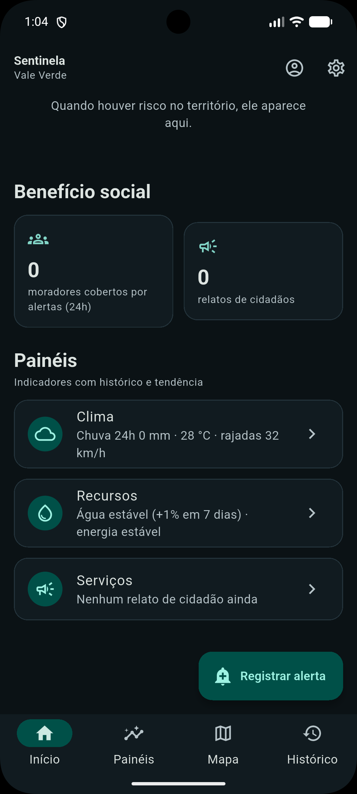 | 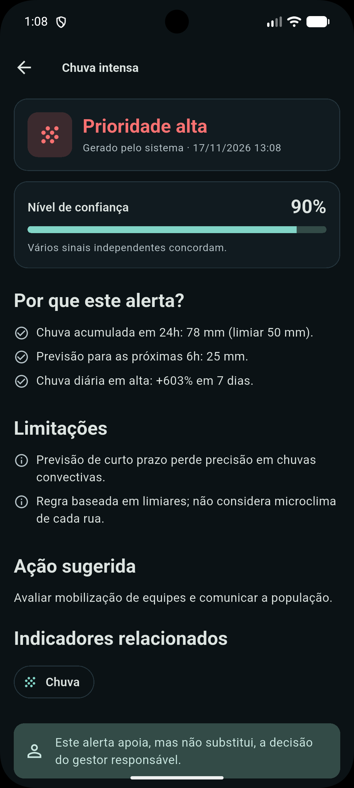 | 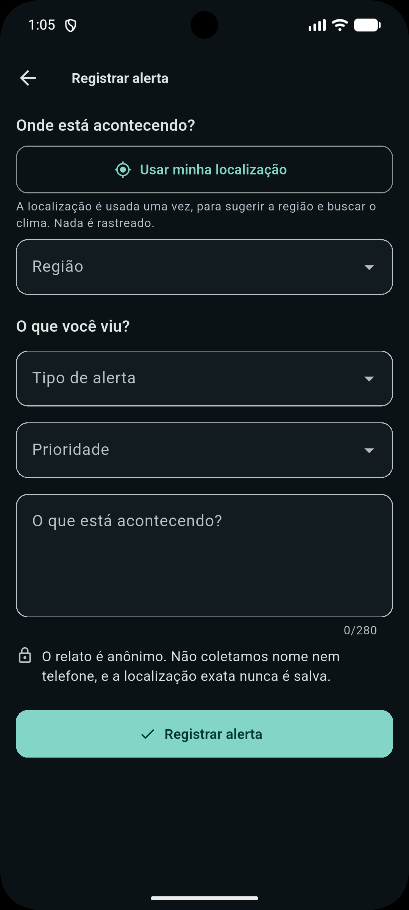 |
| Alertas recentes, benefício social e atalhos para os painéis. | Evidências, confiança, limitações, ação sugerida e aviso de decisão humana. | GPS sugere a região, clima do momento sugere o tipo; relato anônimo. |

| Painel Clima | Painel Recursos | Painel Serviços |
|:---:|:---:|:---:|
| 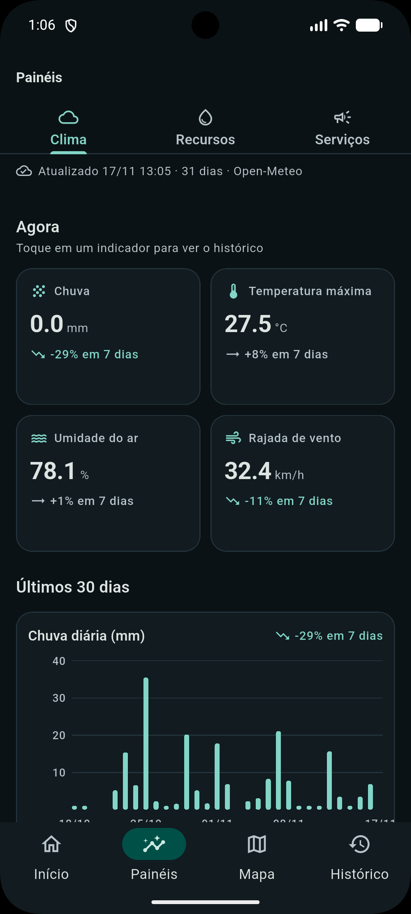 | 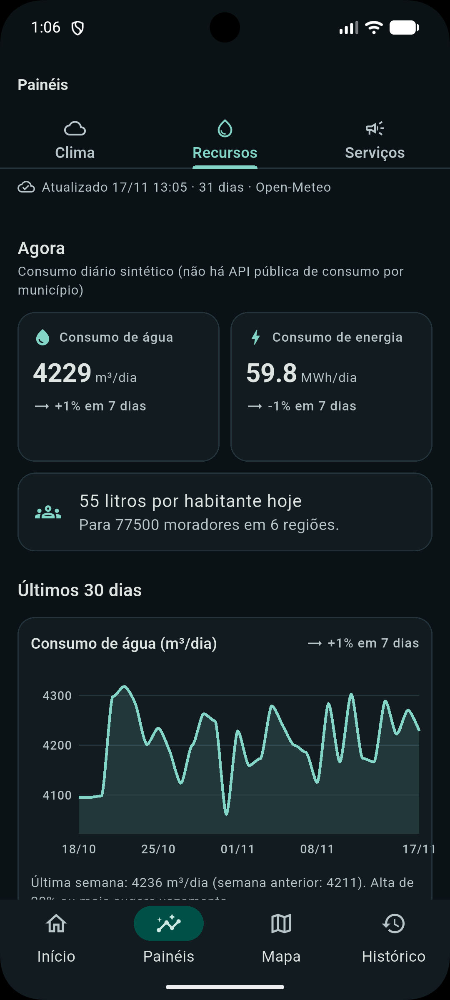 | 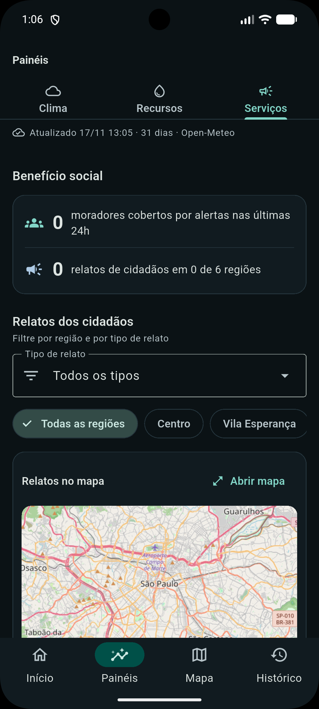 |
| Chuva, temperatura, umidade e vento com histórico de 30 dias e tendência. | Consumo de água e energia, litros por habitante e alertas de desperdício. | Relatos por região e tipo, com filtros, mapa e indicador de benefício social. |

| Detalhe do indicador | Mapa | Histórico |
|:---:|:---:|:---:|
| 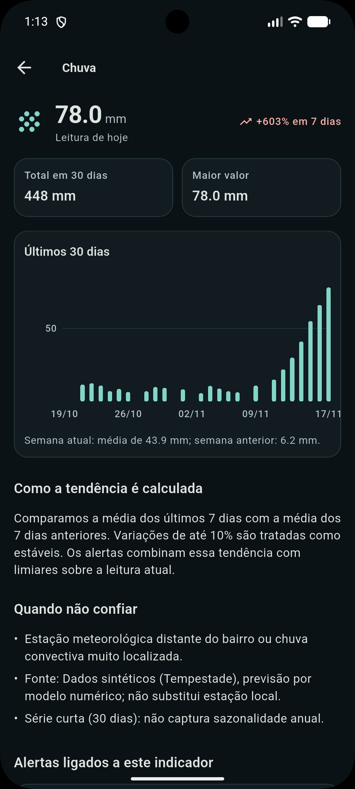 | 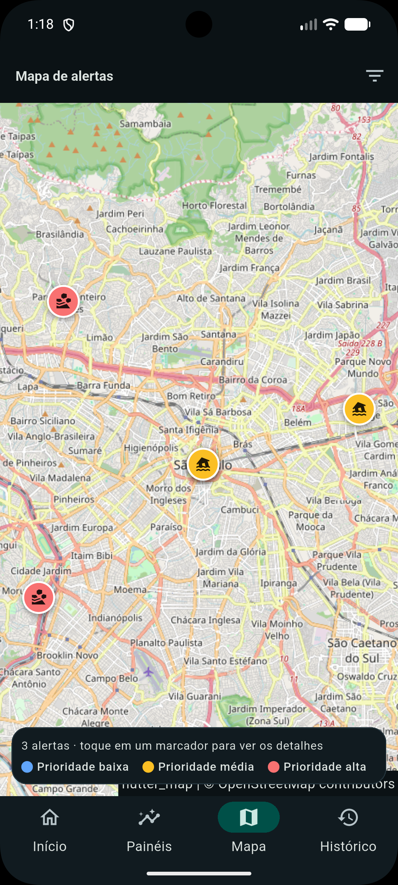 | 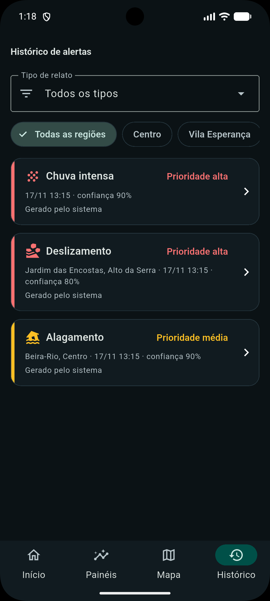 |
| Série de 30 dias, como a tendência é calculada e quando não confiar. | Marcadores por prioridade; toque abre o alerta. | Todos os alertas com filtro por região e tipo. |

| Perfil | Configurações | Limiares |
|:---:|:---:|:---:|
| 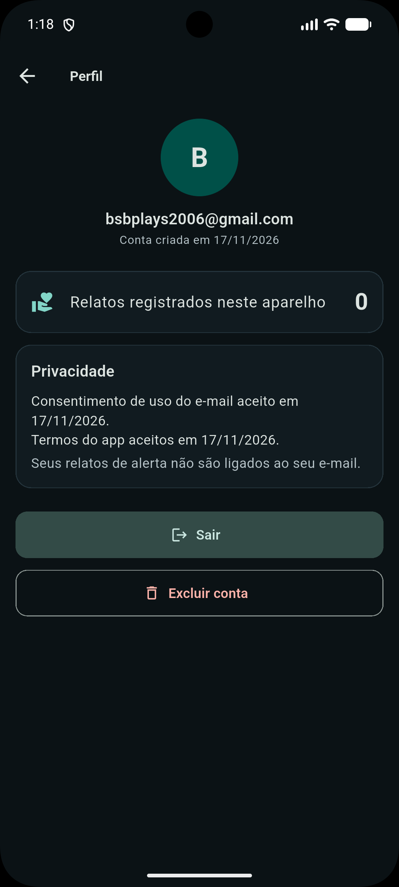 | 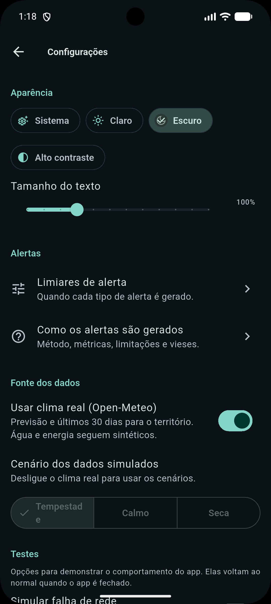 | 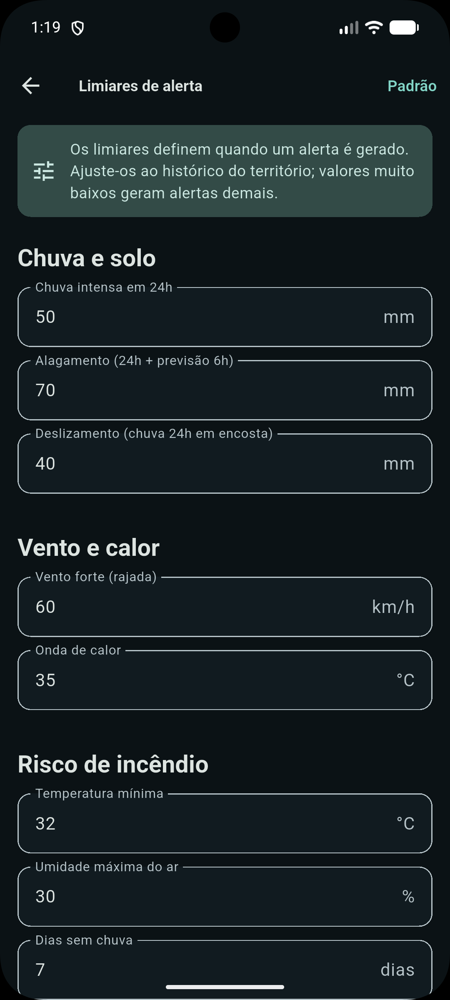 |
| Relatos registrados, datas de consentimento, sair e excluir conta. | Tema, tamanho do texto, fonte dos dados e opções de teste. | Formulário validado que recalcula os alertas na hora. |

| Método | Tela larga | Alto contraste |
|:---:|:---:|:---:|
| 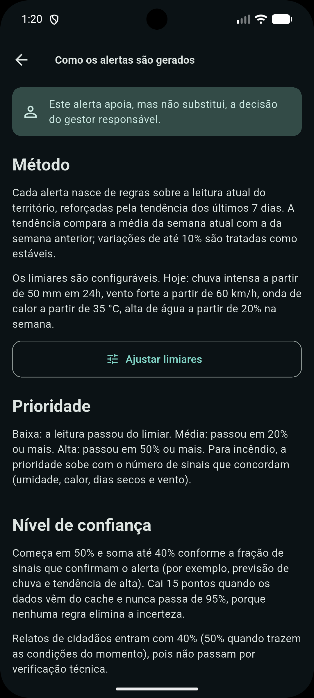 | 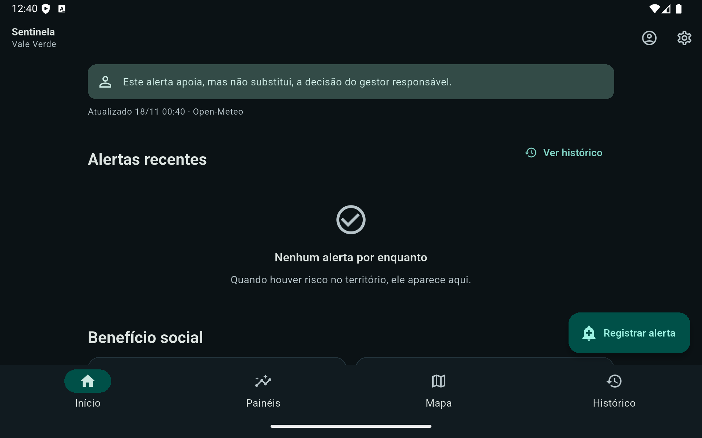 | 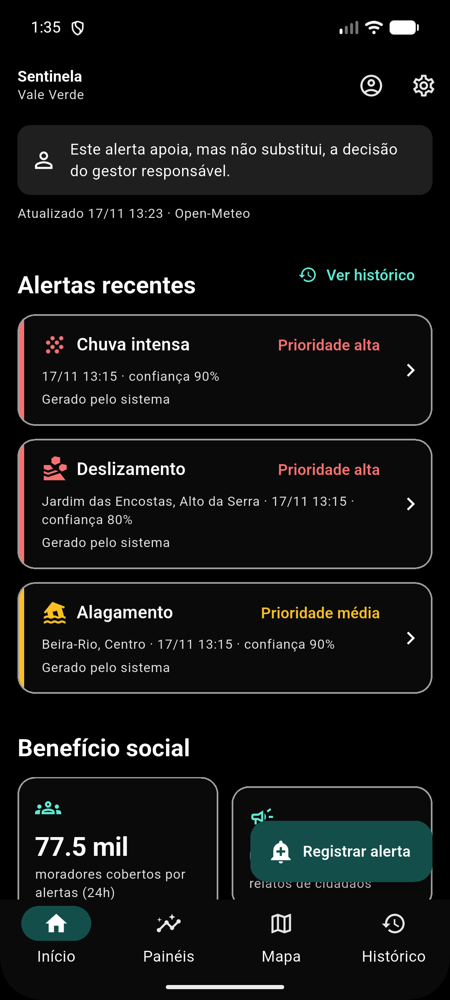 |
| Métricas, limitações, vieses e quando não confiar. | Conteúdo centralizado e grade com 3 colunas. | Tema de alto contraste para baixa visão. |

## 4. Funcionalidades

**Critérios principais**
- [x] 18 telas com rotas nomeadas e passagem de parâmetros (`onGenerateRoute`), barra inferior com 4 abas e fluxo *início → painel → detalhe do indicador → detalhe do alerta*
- [x] 3 dashboards distintos (Clima, Recursos, Serviços) com gráficos de linha e barras, cards de indicador, histórico de 30 dias e tendência semanal
- [x] 8 tipos de alerta gerados por regras sobre leitura atual + tendência, cada um com evidências, nível de confiança, limitações e ação sugerida
- [x] Aviso "apoia, mas não substitui, a decisão humana" em todas as telas de alerta e painel
- [x] Estado global com `provider` (`TerritoryProvider`, `AuthProvider`, `SettingsProvider`) compartilhado por todas as telas; estado local nos formulários e filtros
- [x] Estados de carregamento, erro, lista vazia e offline tratados em todas as listas e painéis
- [x] Consumo de API real (Open-Meteo) com fallback para cenários sintéticos
- [x] Persistência local: alertas, relatos, dataset de 30 dias (cache), limiares, preferências, consentimento e contas
- [x] App útil sem conexão: mostra o cache, sinaliza "dados do cache" e reduz a confiança dos alertas
- [x] 4 formulários com validação e feedback: registro de alerta, login, cadastro e limiares
- [x] Indicadores de benefício social: moradores cobertos por alertas (24h), relatos por região
- [x] Tema próprio (claro, escuro, alto contraste), tipografia e espaçamentos padronizados, componentes reutilizáveis

**Diferenciais**
- [x] Dados reais: Open-Meteo (clima e previsão, sem chave de API)
- [x] Mapa e geolocalização: OpenStreetMap com marcadores por prioridade; GPS no registro
- [x] Temas: modo escuro e tema de alto contraste
- [x] Animações com propósito: entrada escalonada dos alertas, transição entre telas de autenticação
- [x] Testes automatizados: 11 arquivos cobrindo motor de alertas, tendência, validações, autenticação, parser da API e limiares
- [ ] Notificações locais
- [ ] IA generativa
- [ ] APK de release *(ver seção "Como executar")*

## 5. Dados e alertas

### Fontes

| Dado | Fonte | Natureza |
|---|---|---|
| Chuva, temperatura, umidade, rajadas (30 dias), previsão de chuva 6h, umidade do solo | [Open-Meteo](https://open-meteo.com) (CC BY 4.0), ponto central do território | **Real** |
| Condições no momento do relato | Open-Meteo, na coordenada do cidadão | **Real** |
| Consumo diário de água e energia | Gerador determinístico (`SyntheticHistory`) | **Sintético** (não há API pública com consumo diário por município) |
| Regiões, população, suscetibilidade a deslizamento | `Territory` (constantes) | **Sintético** |
| Relatos de cidadãos | Formulário do app | **Autorizado** (anônimo) |

Com a chave "Usar clima real" desligada, todo o conjunto passa a ser sintético, em três cenários (Tempestade, Calmo, Seca) usados nos testes e na demonstração.

### Como os alertas são gerados

O `AlertEngine` aplica **regras por limiar** sobre a leitura atual, **reforçadas pela tendência** dos últimos 7 dias (média da semana atual contra a anterior; variações de até 10% são "estáveis").

| Alerta | Regra (limiares padrão, editáveis no app) |
|---|---|
| Chuva intensa | chuva 24h ≥ 50 mm |
| Alagamento | chuva 24h + previsão 6h ≥ 70 mm, com ao menos 2 de 3 sinais (chuva, previsão, solo saturado) |
| Deslizamento | encosta suscetível **e** solo ≥ 75% **e** chuva 24h ≥ 40 mm |
| Vento forte | rajada ≥ 60 km/h |
| Risco de incêndio | ≥ 3 de 4 sinais: umidade ≤ 30%, temperatura ≥ 32 °C, ≥ 7 dias sem chuva, rajada ≥ 30 km/h |
| Onda de calor | temperatura ≥ 35 °C |
| Desperdício de água | consumo da semana ≥ 20% acima da anterior |
| Pico de energia | consumo do dia ≥ 25% acima da média de 30 dias |

**Prioridade:** Baixa quando passa do limiar; Média a partir de 20% acima; Alta a partir de 50% acima.

**Nível de confiança:** `0,5 + 0,4 × (sinais confirmados / sinais totais)`, menos 0,15 quando os dados vêm do cache, com teto de 0,95. Relatos de cidadãos entram com 0,4 (0,5 com condições do momento anexadas).

### Métricas usadas
- Razão leitura/limiar (quanto o valor passou).
- Variação percentual da média semanal (tendência).
- Dias consecutivos sem chuva; umidade do solo (0–1 cm, normalizada).
- Fração de sinais confirmados por alerta.

### Limitações, vieses e quando não confiar
- O clima vem de **um único ponto**; bairros de serra e vale podem diferir.
- A previsão de 6h é de **modelo numérico** e perde precisão em tempestades localizadas.
- O mapa de **suscetibilidade a deslizamento é estático** e simplificado.
- Consumo de água e energia é **sintético**; os alertas de recursos demonstram o método, não medições reais.
- **Viés de inclusão:** relatos dependem de quem tem celular e conexão; regiões com menos acesso podem parecer mais calmas do que são.
- A série tem **30 dias** e não captura sazonalidade anual.
- Não confie quando o aviso "dados do cache" estiver visível, em eventos extremos fora do histórico recente, quando os limiares foram alterados sem base local, ou para decidir sobre uma rua ou imóvel específico.

Tudo isso está exposto no app, na tela **Como os alertas são gerados** e no detalhe de cada indicador.

## 6. Privacidade e inclusão

**Privacidade**
- Etapa de **consentimento explícito** no primeiro uso, revogável nas configurações; data registrada no perfil.
- Conta **local**: e-mail só identifica a conta no aparelho; senha guardada como **SHA-256 iterado com sal**, nunca em texto.
- **Relatos anônimos**, não ligados ao e-mail. A descrição **bloqueia telefones e e-mails** na validação.
- **Localização sob demanda**: pedida só ao tocar em "Usar minha localização"; se anexada ao relato, é **arredondada a ~1 km**. Nenhum rastreamento em segundo plano.
- Para serviços externos vão apenas as coordenadas do território (ou a do cidadão, se ele pedir).
- **Excluir conta** e **limpar dados** disponíveis no app.

**Acessibilidade e inclusão**
- `Semantics` em cards, gráficos, mapa, marcadores e indicadores (leitor de tela descreve valor, tendência e prioridade).
- **Tamanho do texto** de 85% a 140% somado à escala do sistema; layouts sem altura fixa.
- **Tema de alto contraste** (preto puro, bordas fortes) além de claro e escuro.
- Cores de prioridade sempre acompanhadas de texto e ícone (nunca só cor).
- Animações desligadas quando o sistema pede "reduzir movimento".
- Layout responsivo: conteúdo limitado a 720 px e grade de 3 colunas em telas largas.

## 7. Tecnologias e decisões técnicas

| Escolha | Justificativa |
|---|---|
| **Flutter 3.27+ / Dart 3.8** | Exigência da disciplina; Material 3 e `switch` expressions deixam o código mais curto. |
| **Arquitetura por feature** (`features/<nome>/{domain,data,state,presentation}`) | Cada funcionalidade é autocontida; `domain` sem dependência de Flutter facilita os testes. |
| **provider** | Estado global simples e explícito, suficiente para 3 providers; evita a curva de aprendizado de BLoC/Riverpod num projeto de 10 dias. |
| **Motor de regras próprio** (`AlertEngine`) | Totalmente explicável (evidência por sinal), o que um modelo de ML opaco não daria; os limiares viram um formulário. |
| **Open-Meteo** | API pública real, sem chave (nada a esconder no repositório), com histórico e previsão numa chamada. |
| **flutter_map + OpenStreetMap** | Mapa sem chave de API nem custo; marcadores são widgets Flutter comuns. |
| **geolocator** | Permissões e `getCurrentPosition` com timeout, sem rastreamento contínuo. |
| **shared_preferences + JSON** | Persistência suficiente para o volume do app (alertas, cache de 30 dias, limiares); zero configuração nativa. |
| **fl_chart** | Gráficos de linha e barra com eixos personalizáveis e boa performance. |
| **crypto** | Hash de senha com sal, já que a autenticação é local e simulada. |
| **flutter_launcher_icons** | Ícone adaptativo gerado a partir de um PNG. |

Sem chaves de API nem variáveis de ambiente: todas as fontes são públicas e sem autenticação.

## 8. Como executar

Pré-requisitos: Flutter 3.27 ou superior, Android Studio com SDK, emulador ou aparelho Android.

```bash
git clone https://github.com/[USUARIO]/sentinela.git
cd sentinela
flutter pub get
flutter run
```

Permissões já declaradas em `android/app/src/main/AndroidManifest.xml`: `INTERNET`, `ACCESS_COARSE_LOCATION`, `ACCESS_FINE_LOCATION`.

Outros comandos:

```bash
flutter test                                   # testes de unidade
flutter analyze                                # lints
dart run flutter_launcher_icons               # regenerar o ícone
flutter build apk --release                    # APK em build/app/outputs/flutter-apk/
```

Dicas para demonstração: no emulador, defina a localização em *Extended controls > Location* (ex.: `-23.5505, -46.6333`). Em **Configurações**, desligue "Usar clima real" e escolha o cenário **Tempestade** para ver alagamento e deslizamento, ou **Seca** para incêndio, desperdício de água e pico de energia; ligue "Simular falha de rede" para ver o modo offline.

## 9. Vídeo

[Assista à demonstração (até 3 min)](https://LINK-DO-VIDEO)

## 10. Licença

Projeto acadêmico desenvolvido para a Global Solution 2026.2 da FIAP, disciplina Cross-Platform Application Development. Uso educacional.
Dados de clima: Open-Meteo (CC BY 4.0). Mapas: © OpenStreetMap contributors.
